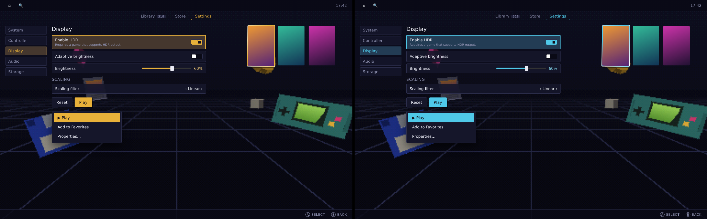

# Lowpoly

A [CSS Loader](https://github.com/DeckThemes/SDH-CssLoader) theme for Steam Game Mode, inspired by late-90s 3D consoles. It's an original design, with no console's interface, logos or trademarks.

## Look

- **A real low-res 3D backdrop.** `images/scene.png` is a 384×216 frame from a tiny software renderer (`tools/render_backdrop.py`): a grid floor fading into fog, flat-shaded low-poly toys (a floppy disk, a cartridge, a pocket console, a gold ring, a gem and a cube), vertices snapped to whole pixels, 15-bit colour and ordered dither. Steam scales it up with hard pixels (`image-rendering: pixelated`), so it looks like a 240p-era render on the handheld's screen.
- **A quiet UI on top:** dark flat rows with thin borders. Settings rows are separate tiles. The selected item gets a warm accent tint and an accent border. Play and primary buttons are solid accent with dark text. There are no gradients and no glow.
- **Tabs:** the current tab is shown in the accent with an underline.
- **Covers:** the focused Recent Games cover turns a few degrees in 3D and casts a hard shadow.

It covers Home, Library, game pages, Settings, the STEAM menu, Quick Access (and Decky panels), Friends & Chat, Store, Downloads, Search, Media, Achievements, the on-screen keyboard and notification toasts.

## Options (Quick Access → CSS Loader → Lowpoly)

| Option | Values | Default |
|---|---|---|
| Accent | Gold, Amber, Crimson, Lime, Cyan, Violet, Silver, Custom (color picker) | Gold |
| Backdrop | 3D scene, Grid only, Plain | 3D scene |
| CRT | Off, Scanlines, Tube | Off |
| Font | Steam default, Pixel labels, Pixel everywhere (Pixelify Sans, bundled) | Steam default |
| Animations | Off, Subtle (stepped focus snaps, menus unfold), Full (+ cursor blink, stepped cover swing, download stripes) | Subtle |

## Install

The easiest way is **Library Hub** in Quick Access: tap Lowpoly → Install.

To install by hand:

1. Download `Lowpoly.zip` from the latest `lowpoly-theme-v*` release.
2. Extract it into `~/homebrew/themes/`, or run `install.sh` next to the zip.
3. Go to CSS Loader → Refresh, then enable **Lowpoly**. Turn off other full themes, such as Nightgrid, first.

The folder must be named `Lowpoly`, because the backdrop and font are loaded from `/themes_custom/Lowpoly/`.

## Performance

The backdrop is a small PNG (about 10 KB) used as a static background on the page containers: it's decoded once and painted once. Nothing is drawn on top of it, and nothing animates idle. The CRT overlay is optional: one static layer on Home/Library that's never drawn over a running game. Looping animations (Full only) stop in-game, and Steam's Low Performance Mode turns all animation off.

## Building

- `./package.sh` creates `out/Lowpoly.zip`.
- `python3 tools/render_backdrop.py Lowpoly/images` re-renders the backdrop (needs numpy and Pillow).
- `.github/workflows/lowpoly-release.yml` publishes a release automatically when the `version` in `Lowpoly/theme.json` changes.

## Credits

- Selectors follow this repo's Nightgrid theme (CSS Loader stable class names).
- Font: [Pixelify Sans](https://github.com/eifetx/Pixelify-Sans), SIL OFL 1.1.
- License: MIT.
